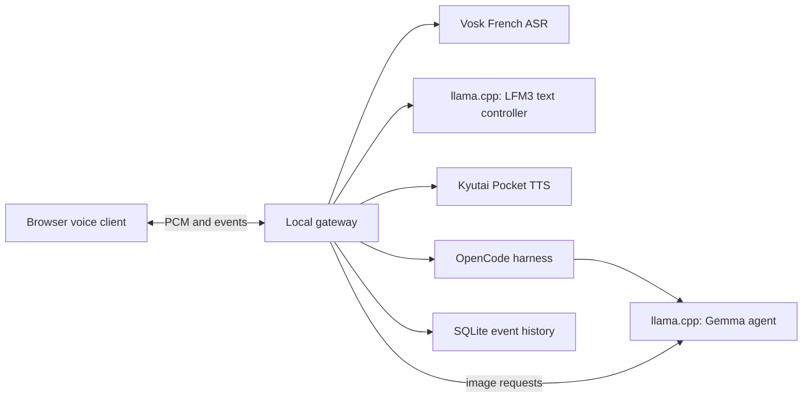
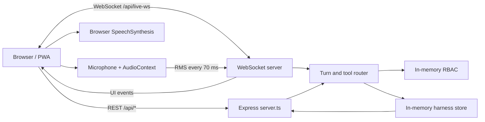

# Architecture and current implementation

## Experimental local voice stack

The browser client in `prototype/client` connects to the loopback gateway in `prototype/gateway.mjs`. Its current voice path is microphone PCM -> Vosk French ASR -> LFM3 text controller -> Pocket TTS -> browser audio. A separate Gemma vision/agent model serves image requests and an OpenCode harness can run background tasks. Gateway conversation and task events are stored in SQLite under `.cache/assistant` or the configured database path. Provider URLs are constrained to loopback by the gateway.

The default gateway port is 18083; the currently running demonstration uses 18088. The service endpoint reports configured engines and models. Speaker-safe, hold-to-talk, manual interruption and a noise threshold exist; the experimental playback-reference filter has not solved speaker feedback reliably. The gateway is a local experiment, not an authenticated multi-user service or OS sandbox. An optional sampled resource check can reject new agent tasks and conservatively accounts for estimated concurrent tasks across connections. It is disabled by default and is not a hard runtime limit or allocation reservation.

Admission estimates are held until the harness reports a terminal result. An ambiguous submission, status failure or timeout keeps the estimate held for the lifetime of the gateway process; restarting the gateway loses this accounting even if external work continues. Estimates can double-count allocations already visible in telemetry, and multiple gateway processes do not coordinate. Model loading, transient spikes, paging and actual allocation remain outside this check.

The gateway defaults to a local SQLite event file; `ASSISTAI_DB_PATH=:memory:` instead uses a process-local SQLite database that disappears on exit. `/health` reports `history_storage` as `file` or `volatile`. This does not control operating-system paging, logs, other processes or backups, and the unauthenticated health response is not a security proof.

A native audio-client comparator uses timestamp-aligned capture and playback in its published implementation. An experimental Windows WASAPI client connects PCM conversion, bounded playback and energy-based turn detection to the gateway; `I` requests manual interruption and `Q` stops the client when attached to a terminal. In synthetic loopback trials its opt-in AEC mode interrupted itself, whereas speaker-safe gating produced no interruption in one run. A separate idealized replay showed that increasing the required speech-onset duration delayed or missed constructed near speech. In one user-reported physical test, a spoken French question was understood and manual interruption worked; earlier synthetic-question physical tests failed at two thresholds. Automatic voice interruption in a real room remains unverified. Receive-side pacing does not ensure bounded buffering across the whole gateway and network. The AEC path dynamically loads a pinned research comparator and is not validated for real-room interruption.

The native Windows client displays the mode reported by the gateway. A simulated-device integration test exercises its native-speech gateway handshake, PCM input and playback using a mock realtime backend and a separate Vosk transcript. This does not validate the real native model or its audible output.

The native client maintains a bounded queue of task-completion notifications. It requests playback only when its local turn and playback state are idle and backs off rejected requests, with at most three attempts. The queue is connection-local and volatile; overflow drops the oldest pending entry, and manual interruption does not replay a notification. Gateway/client races and real-device notification timing remain unverified.

Gateway service discovery identifies native speech inference and an optional parallel transcription service separately. The status endpoint queries the configured transcription sidecar, rather than assuming the cascade's default ASR server; this is health reporting rather than a transcript provenance or authentication guarantee.

On dispatch, the gateway sends OpenCode the explicit task followed by up to 1,800 JSON characters of recent, session-scoped conversation and task events. Individual excerpts are capped at 200 characters, older entries are dropped first, and parallel ASR transcripts are marked approximate. The text is labeled untrusted but the model can still follow malicious instructions within it. This context does not survive client reconnection and does not establish general shared memory, semantic retrieval or task isolation.

The Windows native client optionally feeds explicit local enrollment into a CPU target-speaker extractor. A dedicated worker permits one in-flight call, the capture queue is bounded, and output is reframed into 20 ms PCM. The opt-in path requires speaker-safe mode, discards frames captured during playback or from older playback epochs, and replaces and primes extractor state after gating. It has synthetic-device evidence only; an internal silence warm-up addressed an immediate-onset clipping example in one follow-up test. Physical performance, queue behavior under sustained load and complete cancellation guarantees remain unverified.

A separate opt-in Windows command records an enrollment WAV from the default WASAPI microphone to a new local file. The command buffers capture before exclusive creation, rejects device overflow and does not manage subsequent file retention; its fake-device tests do not establish real-device performance or enrollment quality.

An optional Silero ONNX CPU classifier combines speech probability with the native client's RMS threshold. It is off by default, keeps streaming state per client, and is a speech detector rather than a speaker identity or source-separation system. A synthetic comparison reduced early activation by white noise and tones but did not improve the white-noise transcript or distinguish another synthetic speaker. Gateway and noise trials so far use synthetic input.

When admission rejects a task, the gateway emits a `task.rejected` event. In the cascade path it also speaks a fixed resource-related explanation, because a real controller test generated an incorrect file-access explanation when asked to interpret the tool error. The experimental native-speech path receives the tool failure and UI event but does not yet guarantee the spoken explanation.

On connection the gateway reports session capabilities. The browser uses them to label the cascade or native speech path and to disable text and image input in native mode. An optional CPU Vosk sidecar independently transcribes the same captured PCM; it is not the speech model's internal interpretation. Native transcript and assistant text are recorded with local session events. When an upstream speech session must reset, the gateway supplies a bounded recent selection of these events and task results to the replacement session, labeled as potentially inaccurate or untrusted. After reset, a matching completed task can be reused within the same connection unless the model supplies a rerun flag. One synthetic real-model regression succeeded after two earlier duplicate executions; different wording, stale results, model-selected rerun flags, reconnects and live browser behavior remain limitations.

Native task notifications retrieve only a completed task from the current gateway session, then provide at most 300 characters of its result as data to the voice model with tool calls disabled for that response. The full result is displayed separately. This bounded prompt is not a prompt-injection boundary, and generated speech can omit or distort the result.

### Research-only speech-to-speech paths

MiniCPM-o through llama.cpp-omni and LFM3-Audio through llama.cpp realtime have been exercised with synthetic audio. The latter produced a synthetic French tool call, a read-only OpenCode result, nonzero continuation audio, and explicit cancellation; an opt-in LFM gateway path also passed a synthetic French read-only harness probe and a separate synthetic interruption/follow-up test. It remains experimental: browser microphone behavior, general French speech quality and text/image input are not fully verified. The completion-notification event flow also passed a synthetic real-model test; live browser and audible speech quality remain unverified. MiniCPM-o's experimental server writes temporary audio and debug files. Model and cache quantization, Vulkan staging and concurrent GPU measurements are recorded in the [native duplex notebook](research/2026-11-10-native-duplex.md). The sampled 24 GB budget is not a guaranteed allocation or proof that paging and shared-memory spill never occur.

## Separate React mockup

## Scope

Mochi is a single-process prototype demonstrating a voice interface and agent workspace. Express hosts the REST API, WebSocket, and in-memory demo state. React displays the voice clients, harness, projects, and RBAC console. There is no database or mandatory external service, and state is lost on restart.

## Client and turn flow

`src/App.tsx` loads projects, harness state, and telemetry over REST and registers callbacks with `voiceSocket`. Web, smartphone, and simulated terminal clients share the WebSocket service. A microphone `AudioContext` measures RMS at 16 kHz every 70 ms; an RMS above 0.07 while the agent is speaking triggers an interruption. The server does not receive microphone PCM: the browser speaks the completed response using `SpeechSynthesis`. `vite-plugin-pwa` configures the manifest and service worker.

`server.ts` attaches `/api/live-ws` to Express. It receives text, RMS meters, and interruption messages; searches demo sessions using lexical matching; applies simple lexical tool routing and RBAC checks; then streams a canned textual reply word by word. REST and WebSocket clients share the same in-memory state.

## State and API

`src/types/index.ts` defines projects, sessions, artifacts, integrations, users, permissions, and audit logs. The server maintains `harnessStore` and `authStore`; the browser maintains an interface projection in `authService.ts`.

| Area | Routes | Current behavior |
| --- | --- | --- |
| Health | `GET /api/health` | Declares mode and capabilities. |
| Harness | `GET /api/agent/state`, `POST /api/agent/execute` | Reads state or generates a demo result after RBAC checks. |
| Projects | `GET/POST /api/projects`, session creation/search, `DELETE /api/projects/:id` | Limited in-memory CRUD; deletion checks `delete_project`. |
| Hardware | `GET /api/vram/status`, `GET /api/shared-memory/status` | Static representative values, not hardware measurements. |
| RBAC | `GET /api/auth/state` and `/api/auth/*` mutation routes | Unauthenticated, ephemeral demo state. |
| Scripts/CLI | `/api/scripts/*`, `/api/clients/cli/*` | Generates downloadable scripts and clients; some are permission-gated. |

Mutations are not persistent. The API is not versioned and request bodies are not yet strictly validated. Effective permission is the explicit user override when present, otherwise the role permission. See [RBAC](RBAC.md).

## Production gaps

- Add persistence, migrations, backups, and retention.
- Authenticate each request and enforce server-side authorization; secure and rotate secrets; add an immutable audit log.
- Implement OAuth, least-privilege consent, and CSRF protection for real connectors.
- Isolate code execution with actual filesystem and network policies.
- Replace declared GPU metrics and context limits with measurements.
- Add schema validation, rate limiting, CORS/TLS, observability, integration tests, and appropriate service separation.
- Integrate real local voice and LLM providers before claiming production full-duplex operation. The Gemini key does not activate a complete conversation path.
