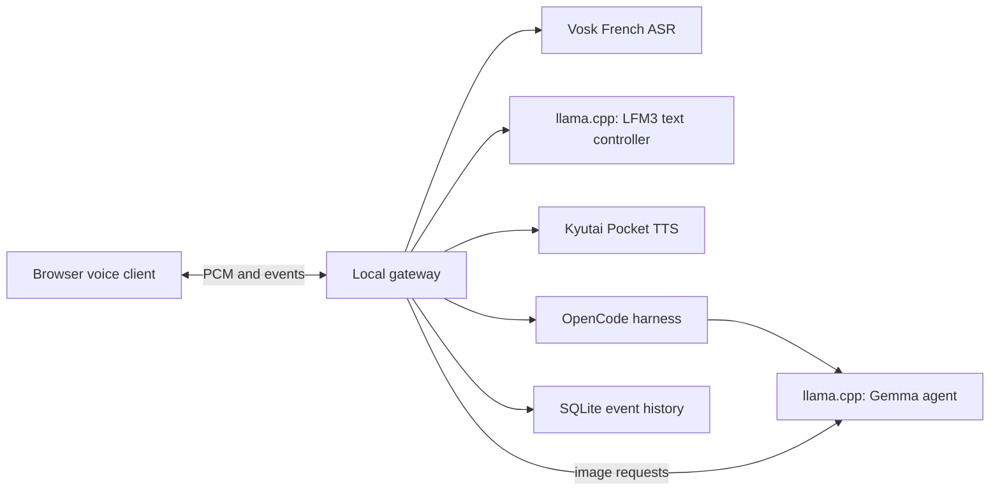
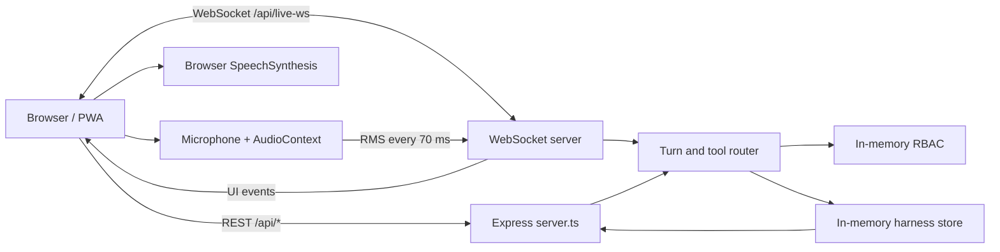

# Architecture and current implementation

## Experimental local voice stack

The browser client in `prototype/client` connects to the loopback gateway in `prototype/gateway.mjs`. Its current voice path is microphone PCM -> Vosk French ASR -> LFM3 text controller -> Pocket TTS -> browser audio. A separate Gemma vision/agent model serves image requests and an OpenCode harness can run background tasks. Gateway conversation and task events are stored in SQLite under `.cache/assistant` or the configured database path. Provider URLs are constrained to loopback by the gateway.

The default gateway port is 18083; the currently running demonstration uses 18088. The service endpoint reports configured engines and models. Speaker-safe, hold-to-talk, manual interruption and a noise threshold exist; the experimental playback-reference filter has not solved speaker feedback reliably. The gateway is a local experiment, not an authenticated multi-user service or OS sandbox. `resource-budget.mjs` provides an isolated policy but is not wired in as a hard runtime limit.

### Research-only speech-to-speech paths

MiniCPM-o through llama.cpp-omni and LFM3-Audio through llama.cpp realtime have been exercised with synthetic audio. The latter produced a synthetic French tool call, a read-only OpenCode result, nonzero continuation audio, and explicit cancellation; an opt-in LFM gateway path also passed a synthetic French read-only harness probe and a separate synthetic interruption/follow-up test. It remains experimental: browser microphone behavior, general French speech quality and text/image input are not fully verified. The completion-notification event flow also passed a synthetic real-model test; live browser and audible speech quality remain unverified. MiniCPM-o's experimental server writes temporary audio and debug files. Model and cache quantization, Vulkan staging and concurrent GPU measurements are recorded in the [native duplex notebook](research/2026-11-10-native-duplex.md). The sampled 24 GB budget is not a guaranteed allocation or proof that paging and shared-memory spill never occur.

## Separate React mockup

## Scope

Mochi is a single-process prototype demonstrating a voice interface and agent workspace. Express hosts the REST API, WebSocket, and in-memory demo state. React displays the voice clients, harness, projects, and RBAC console. There is no database or mandatory external service, and state is lost on restart.

## Client and turn flow

`src/App.tsx` loads projects, harness state, and telemetry over REST and registers callbacks with `voiceSocket`. Web, smartphone, and simulated terminal clients share the WebSocket service. A microphone `AudioContext` measures RMS at 16 kHz every 70 ms; an RMS above 0.07 while the agent is speaking triggers an interruption. The server does not receive microphone PCM: the browser speaks the completed response using `SpeechSynthesis`. `vite-plugin-pwa` configures the manifest and service worker.

`server.ts` attaches `/api/live-ws` to Express. It receives text, RMS meters, and interruption messages; searches demo sessions using lexical matching; applies simple lexical tool routing and RBAC checks; then streams a canned textual reply word by word. REST and WebSocket clients share the same in-memory state.

## State and API

`src/types/index.ts` defines projects, sessions, artifacts, integrations, users, permissions, and audit logs. The server maintains `harnessStore` and `authStore`; the browser maintains an interface projection in `authService.ts`.

| Area | Routes | Current behavior |
| --- | --- | --- |
| Health | `GET /api/health` | Declares mode and capabilities. |
| Harness | `GET /api/agent/state`, `POST /api/agent/execute` | Reads state or generates a demo result after RBAC checks. |
| Projects | `GET/POST /api/projects`, session creation/search, `DELETE /api/projects/:id` | Limited in-memory CRUD; deletion checks `delete_project`. |
| Hardware | `GET /api/vram/status`, `GET /api/shared-memory/status` | Static representative values, not hardware measurements. |
| RBAC | `GET /api/auth/state` and `/api/auth/*` mutation routes | Unauthenticated, ephemeral demo state. |
| Scripts/CLI | `/api/scripts/*`, `/api/clients/cli/*` | Generates downloadable scripts and clients; some are permission-gated. |

Mutations are not persistent. The API is not versioned and request bodies are not yet strictly validated. Effective permission is the explicit user override when present, otherwise the role permission. See [RBAC](RBAC.md).

## Production gaps

- Add persistence, migrations, backups, and retention.
- Authenticate each request and enforce server-side authorization; secure and rotate secrets; add an immutable audit log.
- Implement OAuth, least-privilege consent, and CSRF protection for real connectors.
- Isolate code execution with actual filesystem and network policies.
- Replace declared GPU metrics and context limits with measurements.
- Add schema validation, rate limiting, CORS/TLS, observability, integration tests, and appropriate service separation.
- Integrate real local voice and LLM providers before claiming production full-duplex operation. The Gemini key does not activate a complete conversation path.
