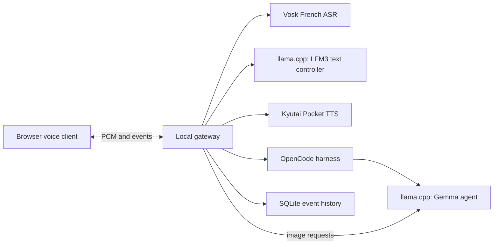
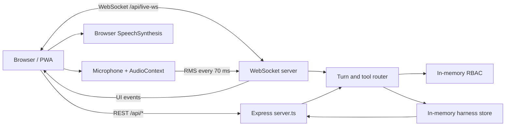

# Architecture and current implementation

## Experimental local voice stack

The browser client in `prototype/client` connects to the loopback gateway in `prototype/gateway.mjs`. Its current voice path is microphone PCM -> Vosk French ASR -> LFM3 text controller -> Pocket TTS -> browser audio. A separate Gemma vision/agent model serves image requests and an OpenCode harness can run background tasks. Gateway conversation and task events are stored in SQLite under `.cache/assistant` or the configured database path. Provider URLs are constrained to loopback by the gateway.

In cascade mode, a selected image can accompany the final transcript of the next spoken question if the gateway advertises this capability. One synthetic French question and generated red image passed through the real gateway and local services; live browser and real-world vision behavior remain unverified. The native speech bridge does not support image input. Image bytes are sent to the configured local vision endpoint and are not placed in gateway event history. A separate speech projection removes common markup and substitutes cues for code and links before Pocket TTS; the displayed answer retains these details except for explicit reasoning blocks. This is heuristic and can omit content from speech.

Cascade model answers first discard explicit `<think>` and `<analysis>` sections, including unclosed blocks, before display, storage and TTS. Explicit sections in task notification excerpts are also filtered for speech. Other reasoning formats and unmarked reasoning may pass through; the native speech bridge emits model audio directly and does not use this text filter.

The browser detects when an audio chunk arrives more than 30 ms after the previously scheduled playback end during the same speech stream. It logs the count and longest observed gap when that stream ends. This client-clock diagnostic does not attribute gaps to synthesis, network, browser scheduling or the audio device and cannot detect pronunciation errors.

For a spoken task notification, the browser keeps the notification associated with the active playback until both the server's speech stream has ended and the queued audio sources have finished. If playback is interrupted before then, it puts the notification back in the pending queue. The Web Audio [`ended` event](https://developer.mozilla.org/en-US/docs/Web/API/AudioScheduledSourceNode/ended_event) also fires after a source is stopped, so callbacks for sources removed during interruption are ignored. A browser simulation covers interruption after `speech.end` while audio is still queued, and completion after the final source ends. This does not verify physical playback, audible delivery or persistence across a connection loss; reconnecting currently clears the pending queue.

The browser offers an explicit replay of the latest completed task, including one found in the bounded resumed-session history. Replay creates or resumes the browser audio context and queues the existing `notification.speak` request when idle; it does not automatically replay history on reconnect. The gateway's existing completed-result lookup limits the request to the current session. Simulated browser and mock-service integration tests cover the request, deduplication and session-scoped lookup; real browser playback and model speech are unverified. A disconnected client clears the selected task, which is restored only if the bounded history contains it after reconnect.

An optional `ASSISTAI_WORKSPACE_LABEL` is sent in session capabilities and displayed as text so an operator can identify the intended harness workspace. The supplied Windows launchers set distinct labels for the read-only fixture and opt-in disposable edit fixture. This is an operator-configured description, not a verified or enforced workspace boundary. The browser falls back to an explicit unknown-workspace message if the label is absent.

The separate web-research fixture identifies hosted search and page requests. Its model and gateway are local, but search queries and fetched pages use external services. Its tool rules are not network isolation or prompt-injection protection.

Cancellation events carrying a turn ID are ignored when they match neither the currently playing response nor the current notification, preventing a delayed cancellation from stopping newer playback. A notification interrupted before its first audio chunk is also requeued. The simulated client test covers both cases. Events without a turn ID retain the legacy unscoped behavior, and this does not establish correctness for every possible event ordering or a physical browser session.

Consecutive chunks now start at the end of the existing playback queue while it remains ahead of the audio clock. A 40 ms lead is added at the beginning of a stream or following an underrun. The former unconditional lead could create a gap when less than 40 ms was queued; a mock-clock test verifies adjacency, while actual browser playback still needs listening validation.

The default gateway port is 18083; the currently running demonstration uses 18088. The service endpoint reports configured engines and models. Speaker-safe, hold-to-talk, manual interruption and a noise threshold exist; the experimental playback-reference filter has not solved speaker feedback reliably. The gateway is a local experiment, not an authenticated multi-user service or OS sandbox. An optional sampled resource check can reject new agent tasks and conservatively accounts for estimated concurrent tasks across connections. It is disabled by default and is not a hard runtime limit or allocation reservation.

Admission estimates are held until the harness reports a terminal result. An ambiguous submission, status failure or timeout keeps the estimate held for the lifetime of the gateway process; restarting the gateway loses this accounting even if external work continues. Estimates can double-count allocations already visible in telemetry, and multiple gateway processes do not coordinate. Model loading, transient spikes, paging and actual allocation remain outside this check.

The gateway defaults to a local SQLite event file; `ASSISTAI_DB_PATH=:memory:` instead uses a process-local SQLite database that disappears on exit. `/health` reports `history_storage` as `file` or `volatile`. This does not control operating-system paging, logs, other processes or backups, and the unauthenticated health response is not a security proof.

A native audio-client comparator uses timestamp-aligned capture and playback in its published implementation. An experimental Windows WASAPI client connects PCM conversion, bounded playback and energy-based turn detection to the gateway; `I` requests manual interruption and `Q` stops the client when attached to a terminal. In synthetic loopback trials its opt-in AEC mode interrupted itself, whereas speaker-safe gating produced no interruption in one run. A separate idealized replay showed that increasing the required speech-onset duration delayed or missed constructed near speech. In one user-reported physical test, a spoken French question was understood and manual interruption worked; earlier synthetic-question physical tests failed at two thresholds. Automatic voice interruption in a real room remains unverified. Receive-side pacing does not ensure bounded buffering across the whole gateway and network. The AEC path dynamically loads a pinned research comparator and is not validated for real-room interruption.

The native Windows client displays the mode reported by the gateway. A simulated-device integration test exercises its native-speech gateway handshake, PCM input and playback using a mock realtime backend and a separate Vosk transcript. This does not validate the real native model or its audible output.

The native client maintains a bounded queue of task-completion notifications. It requests playback only when its local turn and playback state are idle and backs off rejected requests, with at most three attempts. The queue is connection-local and volatile; overflow drops the oldest pending entry, and manual interruption does not replay a notification. Gateway/client races and real-device notification timing remain unverified.

Gateway service discovery identifies native speech inference and an optional parallel transcription service separately. The status endpoint queries the configured transcription sidecar, rather than assuming the cascade's default ASR server; this is health reporting rather than a transcript provenance or authentication guarantee.

Reported endpoint URLs omit userinfo, query strings and fragments; this does not redact arbitrary provider metadata or URL path components and is not an authentication boundary. The service checks do not establish actual generation quality or memory residency.

An experimental coding probe targets a separately configured disposable workspace and validates a narrow arithmetic fixture without executing generated code. One guarded real cascade run delegated and completed the fix while producing a separate follow-up response and audio; an earlier run was stopped below the RAM reserve. Input was synthetic text, the audio was not listened to, and these results do not establish general coding quality or an OS sandbox.

The Windows trial accepts explicit distinct agent and gateway ports, checks they are free, and tracks its own processes. This permits a trial alongside existing demo listeners when resource preflight succeeds; port separation does not isolate memory or grant filesystem confinement.

After the stopped spoken-coding trial, the idle agent model retained significant process working set. An attempt to erase its idle prompt cache was rejected by the installed server because slot actions were not enabled at startup. No automatic recovery or model restart is implemented; the resource monitor remains advisory.

A synthetic French audio variant reached ASR, task delegation and a distinct follow-up response, but was stopped below the RAM reserve before the fixture was fixed. The recorded events did not preserve the transcription for that interrupted run. This is not a completed spoken coding test.

A later guarded synthetic spoken coding run recorded a distorted filename and lost operation distinction in the transcript; the controller delegated the opposite operation. The watchdog stopped the trial below the RAM reserve, with the fixture unchanged. This failure shows the current voice-to-harness path is not dependable for coding, and resource headroom remains inadequate for sustained combined operation.

The cascade can optionally hold a recognized speech turn for transcript review before any controller or vision request. A connection-scoped review ID binds the edited text to a pending turn and its optional image; submission consumes it, while disabling review or disconnecting drops it. The browser pauses further capture while a review is pending. This mode is off by default, unavailable in native speech mode, and tested with mocks rather than live microphone use.

A separate guarded ASR probe prepares fixed synthetic French cases for operation direction, negation and a filename without launching an agent. Its metrics include word error and token order but do not establish semantic equivalence or live-microphone accuracy. Its first preflight did not meet the 8 GiB RAM threshold.

An existing quantized Kyutai French/English STT checkpoint is a research candidate. Its local model directory lacks the codec and tokenizer named in its configuration; upstream Rust source has a GGUF/CPU path, but an installed runtime, Windows execution, Intel acceleration and the complete memory footprint have not been verified.

A separately installed pinned CrispASR Windows CPU research binary lists Kyutai and FastConformer backends. A local French Q8 FastConformer checkpoint completed one guarded three-phrase synthetic comparison. The binary does not advertise native streaming for either backend; live latency, broad accuracy and sustained memory use remain untested. It is not connected to the demo.

The offline comparison probe feeds the same synthetic PCM to Vosk and the file-oriented CrispASR candidate. Candidate timing includes a fresh model load for each phrase and is not an equivalent live latency comparison. In one run, both failed to reproduce the filename; the first candidate attempts had instead timed out waiting at a language-model download prompt.

A local Voxtral Realtime Q4 checkpoint and a pinned Windows transcribe.cpp CPU/Vulkan library are being investigated as a streaming-ASR alternative. CPU backend discovery succeeded without a model; Vulkan initialization, model loading and an adapter are unverified. The library's documented 0.x API requires serialized compute per model and version-matched ABI handling.

The pinned API's generic encoder attention KV type exposes AUTO, FP16 and FP32, with AUTO documented as FP16 for quantized weights; it does not expose a quantized option through that field. Its generic `n_ctx` parameter is documented as ignored for Voxtral Realtime. This does not establish the representation of every family-specific cache, and neither a complete memory bound nor conformance to the requested quantized-KV budget is proven.

Source inspection resolves the family-specific streaming rings in the pinned version: the encoder ring is FP32 and the default decoder ring is FP16. The local GGUF's metadata implies 768 MiB and 832 MiB respectively for the K/V tensors, before allocation overhead, graph buffers and weights. This is a source-derived estimate, not a measured device allocation; quantized KV is not implemented for these rings in this path.

The gateway can request OpenCode cancellation for an active task ID belonging to the current session. A positive abort response is reported only as a request, not verified termination; the normal status poll remains responsible for terminal events and resource-estimate release. The browser tracks concurrently started tasks and targets the most recent one without an outstanding cancellation request. Mock integration covers session scoping and retention after uncertain status; there is no live-agent cancellation validation or rollback.

Task polling considers a result only when the session has no active status and the latest message is a completed assistant message. It does not fall back to an older completed assistant message when a newer message is unfinished. A `tool-calls` or unknown finish remains pending; an output-limit `length` finish is reported as an error rather than success. This avoids several false-completion cases after interruption; missing status is not proof that an upstream task succeeded, and stuck or incomplete messages remain uncertain.

In the browser's automatic speech mode, idle capture remains local in a ten-frame pre-roll until the energy detector starts a turn; the pre-roll is then sent before subsequent frames. This bounds idle audio sent to ASR but is not target-speaker separation. Speaker-safe and push-to-talk discard the automatic-mode pre-roll when their gates are active.

For the cascade recognizer, the gateway clears accumulated transcript segments on the ordered ASR reset acknowledgement as well as on the reset request, so a late segment from before the reset is not carried into the next utterance. This assumes the local recognizer's acknowledgement ordering; it does not correct recognition or delegation errors. See EXP-196.

The browser can enumerate available audio inputs and request a selected input by device ID; the choice takes effect on the next capture start. Device availability and labels depend on browser permission and the operating system. No virtual audio device or external echo canceller is installed by this selector.

Automatic speech turns end after a configurable quiet interval, default 1.4 seconds; push-to-talk ends on release. Longer intervals tolerate pauses at the cost of response latency and do not separate nearby speakers.

In experimental native speech mode, interrupting while a tool submission is pending replaces the realtime voice session, discards its late tool response and signals reconnection to the browser. Input arriving during session setup or cancellation is buffered up to 96,000 PCM bytes (three seconds at 16 kHz mono PCM16) and then flushed; overflow discards that input and fails explicitly. The background task may already have been accepted and continues independently; interrupting voice does not cancel or undo it. This race is covered by mock tests, not yet by a live native model or physical audio test.

The optional Windows resource sample can include total system pagefile usage. This is not attributed to a process, is not a hard memory limit, and does not prove where model data resides. Resource status warns above the conservative total shared-GPU threshold independently of whether task admission is configured.

An optional shared SQLite reservation ledger serializes estimated task admission among gateways configured with the same path. It stores reservation IDs, process IDs, timestamps, estimated RAM/VRAM and, once created, the OpenCode session ID; it does not store conversation text. Estimates remain after a crash or uncertain task and require deliberate reconciliation after independently confirming work has stopped. Older gateways, direct inference clients and services outside that ledger remain unaccounted for; measured snapshots and reservations do not enforce physical memory limits.

During polling, transitions between OpenCode's busy and retry states are sent as sanitized task-progress events and added to the bounded session context. The browser displays them without interrupting speech; the assistant may use them in a later response. Raw provider error messages and agent reasoning are not included in these events. Polling can miss short transitions and is not proof of ongoing execution.

If prompt submission may have reached OpenCode or polling later fails, the gateway emits `task.uncertain`, retains the task ID and estimate, and refuses to resubmit the same normalized request in that session. It continues to accept cancellation requests for that ID. Status polling retries up to three consecutive failures and can recover; ambiguous submission and exhausted retries remain uncertain, and a restart loses this process-local task map even if external work continues.

Uncertainty and subsequent monitoring recovery are also recorded in bounded conversation and resumed task history. Recovery means polling resumed, not that the task succeeded; older context can still be evicted. This is reporting, not authorization or durable reconciliation. See EXP-195.

The guarded probe can now request a completion notification in that spoken-input variant, after the follow-up speech finishes and the task completes. Mock tests cover this ordering; the first real-run preflight failed the 10 GiB available-RAM threshold, so the combined path remains unverified with real inference.

On dispatch, the gateway sends OpenCode the explicit task followed by up to 1,800 JSON characters of recent, session-scoped conversation and task events. Individual excerpts are capped at 200 characters, older entries are dropped first, and parallel ASR transcripts are marked approximate. The text is labeled untrusted but the model can still follow malicious instructions within it. An optional session-resume capability can reconnect the same browser session to retained SQLite events; it does not establish general shared memory, semantic retrieval or task isolation.

Session resume is disabled unless `ASSISTAI_ENABLE_SESSION_RESUME=1`. The browser explicitly creates a random 256-bit key, keeps it in local storage and sends it as a WebSocket subprotocol. The gateway derives a session identifier with SHA-256, rejects concurrent use of the same identifier and restores its bounded event context. File-backed SQLite can survive gateway restart; volatile history cannot. Starting resume creates a new session, while stopping it deletes only the browser key. Mock-service tests cover reconnect, separation, duplicate connection and restart, plus native context restoration. The native bridge reconstructs at most 100 completed results from matching start and completion records among the last 400 task events of that session. Active task tracking survives same-process reconnects, but not gateway restarts; completion and error events go to the currently connected client, if any. Events occurring while disconnected are not replayed and notification queues are not restored. The key is a bearer capability, not user authentication, encryption, RBAC or OS isolation.

On resume, the gateway also sends at most 20 recent same-session task events as a historical snapshot. The browser displays these records without announcing them as new completions. A prior start is not proof that a task is still running. This is not an acknowledged event replay: older records can fall outside the window, history can repeat on reload, and no missed speech notification is automatically restored.

The Windows B60 demo launcher can start a separate updated gateway and resource sampler on port 18089, reusing existing inference services and the read-only fixture harness. It enables opt-in resume with volatile storage and advisory per-task admission. Its ownership record permits identity-checked shutdown of only the processes it started; it does not manage the model servers. The older gateway on port 18088 remains separate. The admission estimates and sampled telemetry are not hard memory enforcement.

The Windows native client optionally feeds explicit local enrollment into a CPU target-speaker extractor. A dedicated worker permits one in-flight call, the capture queue is bounded, and output is reframed into 20 ms PCM. The opt-in path requires speaker-safe mode, discards frames captured during playback or from older playback epochs, and replaces and primes extractor state after gating. It has synthetic-device evidence only; an internal silence warm-up addressed an immediate-onset clipping example in one follow-up test. Physical performance, queue behavior under sustained load and complete cancellation guarantees remain unverified.

An optional `/resources` status endpoint reads a separately configured recent sampler file and exposes sampled whole-adapter dedicated/shared GPU use and available system RAM to the browser. It reports low-reserve, stale and unavailable states and distinguishes disabled from advisory task admission. This is read-only telemetry: it neither reserves memory nor proves model residency, prevents paging, or enforces a hard GPU budget.

If reporting and admission read the same sample, the endpoint also evaluates the configured estimate for one task against that snapshot. It excludes process-local active task estimates and can differ from the subsequent admission decision; a changed sample or concurrent work can also change the result. A separate reporting sample produces no projection.

A separate opt-in Windows command records an enrollment WAV from the default WASAPI microphone to a new local file. The command buffers capture before exclusive creation, rejects device overflow and does not manage subsequent file retention; its fake-device tests do not establish real-device performance or enrollment quality.

A standalone LocalVQE physical probe uses timestamped WASAPI callbacks, estimates delay and processes a bounded in-memory capture offline. One uncontrolled test could not accept a delay estimate or demonstrate physical echo cancellation. This research path is separate from the live client and does not implement live audio alignment or interruption.

An optional Silero ONNX CPU classifier combines speech probability with the native client's RMS threshold. It is off by default, keeps streaming state per client, and is a speech detector rather than a speaker identity or source-separation system. A synthetic comparison reduced early activation by white noise and tones but did not improve the white-noise transcript or distinguish another synthetic speaker. Gateway and noise trials so far use synthetic input.

When admission rejects a task, the gateway emits a `task.rejected` event. In the cascade path it also speaks a fixed resource-related explanation, because a real controller test generated an incorrect file-access explanation when asked to interpret the tool error. The experimental native-speech path receives the tool failure and UI event but does not yet guarantee the spoken explanation.

An optional gateway pressure detector (`ASSISTAI_CANCEL_ON_PRESSURE=1`) requests cancellation after two distinct fresh low-resource observations while polling a task. It sends the existing cancellation event and preserves the reservation until completion is confirmed. This is reactive and best-effort, stops monitoring when polling stops, and does not enforce GPU or RAM limits. It has only been tested with a simulated harness and resource samples.

Cascade speech generation has an inactivity timer covering response headers and each streamed chunk. A timeout aborts the TTS request and sends a turn-specific error instead of `speech.end`; the client can stop partial playback. It does not detect all truncated streams, because the current Pocket TTS WAV header uses a placeholder length. Mock integration verifies a stalled stream and recovery, not a real model stall or audible playback.

The experimental Kyutai CPU sidecar implements the ASR protocol by buffering an utterance and starting a local file-mode subprocess. It has no streaming partials, uses a sampled resource guard and a bounded temporary WAV, and is not enabled in the main demo. It does not establish full-duplex interruption or prevent host-memory paging.

Historical direct-to-OpenCode experiment scripts operate outside gateway admission and submit directly. The older direct edit probe uses static AST verification instead of executing generated fixture code.

The gateway now submits tasks directly to the configured harness without an approval gate. Task lifecycle events remain local; they do not authenticate users or prevent other local callers from invoking the harness.

The experimental native bridge's model instruction also describes direct delegation and distinguishes acceptance from completion. This instruction is not a guarantee of model behavior; the correction has simulated integration coverage and requires a gateway restart to take effect.

The native realtime adapter accepts up to four distinct tool calls in one response. It starts their bridge handlers without waiting for each other, collects each result, then sends results in original call order before requesting a model continuation. Duplicate identifiers and excessive call counts close the session before those calls are emitted. The gateway's existing resource admission still applies independently to each delegated task; it is advisory, not a hardware reservation. An integration test exercises a real gateway against simulated model, harness and resource services; parallel model or harness execution has not been verified for this path. Existing gateways require a restart to load the change.

On connection the gateway reports session capabilities. The browser uses them to label the cascade or native speech path and to disable text and image input in native mode. An optional CPU Vosk sidecar independently transcribes the same captured PCM; it is not the speech model's internal interpretation. Native transcript and assistant text are recorded with local session events. When an upstream speech session must reset, the gateway supplies a bounded recent selection of these events and task results to the replacement session, labeled as potentially inaccurate or untrusted. After reset or opt-in reconnect, a matching completed task can be reused unless the model supplies a rerun flag. One synthetic real-model reset regression succeeded after two earlier duplicate executions; reconnect reuse has mock-service evidence only. Different wording, incomplete history, in-flight work, stale results and model-selected rerun flags remain limitations.

Native task notifications retrieve only a completed task from the current gateway session, then provide at most 300 characters of its result as data to the voice model with tool calls disabled for that response. The full result is displayed separately. This bounded prompt is not a prompt-injection boundary, and generated speech can omit or distort the result.

Cascade task notifications retrieve a completed event from the same session and send a normalized excerpt of at most 300 Unicode characters directly to TTS. The notification is labeled as an excerpt and the full result remains in the client. Mock-service tests cover the TTS request and rejection of another session's task ID. One real-agent synthetic text run produced notification audio after completing a fixture task. A separate synthetic TTS-to-ASR check recognized two of three marker words; audible quality and general synthesis accuracy remain unverified.

The native and cascade paths look up requested completed notifications by session and task ID in retained history, independently of the limited context window. This avoids losing a queued result when later progress events fill the window; it does not replay historical notifications automatically or guarantee storage retention. See EXP-197.

The browser retries a notification rejected as busy up to three times with a short delay, then reports the failure and keeps the written result in the conversation. Unavailable results and unclassified rejections are reported without retry. This is a bounded best-effort queue, not a delivery guarantee; the retry behavior has mock coverage, not a live browser validation.

The cascade gateway validates its expected mono PCM16 WAV stream and treats empty or odd-byte PCM output as an error. A turn-scoped speech error clears browser playback for that turn; unrelated errors do not stop the current audio. This detects malformed or empty streams, not semantically truncated speech or arbitrary WAV variants.

The browser retries a dropped gateway WebSocket with a capped backoff, except after a policy rejection. It pauses audio transmission while disconnected, resets a held push-to-talk press, preserves text submitted while disconnected, and resumes an already enabled microphone when recognition is ready. If cascade ASR disconnects, the gateway closes the client connection to trigger reconnection. Without a resume capability, the new connection has a new session. Mock tests do not establish physical microphone or browser behavior under real network faults.

The experimental native bridge also closes the client connection when its active realtime backend unexpectedly closes, enabling browser reconnect. Intentional replacement of a native session for a reset or interruption does not close the client. A native terminal client's recovery is not established. See EXP-200.

### Research-only speech-to-speech paths

MiniCPM-o through llama.cpp-omni and LFM3-Audio through llama.cpp realtime have been exercised with synthetic audio. The latter produced a synthetic French tool call, a read-only OpenCode result, nonzero continuation audio, and explicit cancellation; an opt-in LFM gateway path also passed a synthetic French read-only harness probe and a separate synthetic interruption/follow-up test. It remains experimental: browser microphone behavior, general French speech quality and text/image input are not fully verified. The completion-notification event flow also passed a synthetic real-model test; live browser and audible speech quality remain unverified. MiniCPM-o's experimental server writes temporary audio and debug files. Model and cache quantization, Vulkan staging and concurrent GPU measurements are recorded in the [native duplex notebook](research/2026-11-10-native-duplex.md). The sampled 24 GB budget is not a guaranteed allocation or proof that paging and shared-memory spill never occur.

LFM3-Omni-2B is a separate experimental candidate, not the default cascade. In two synthetic French trials it delegated a fixture read to a real local read-only OpenCode harness and produced notification audio. The correct result was returned as text; independent speech recognizers disagreed on the saved notification. Two synthetic images were identified in separate HTTP requests, not during the voice session. Sampled concurrent resource figures and reproducible limitations are recorded in the [candidate notebook](research/2026-11-17-lfm3-omni-candidate.md). These tests do not establish human intelligibility, simultaneous conversation, general coding ability, or a hard no-spill memory limit.

The browser separately displays the latest agent event received from the gateway, including submission, rejection, uncertainty, completion or failure. Assistant-generated text alone does not change that indicator. It describes the latest event rather than a complete parallel-task dashboard; after reconnect, earlier work may still be running. This does not prevent the speech model from incorrectly asserting that it delegated a task. The observed false assertion and the reverted configuration that exposed it are documented in the candidate notebook.

An isolated headless Chrome test used a synthetic WAV as its fake microphone and a temporary native gateway connected to the real model and read-only harness. A later run also observed explicit notification start, captured the browser's scheduled notification audio and returned the correct fixture result. Two independent recognizers did not faithfully transcribe the French notification; human intelligibility and real-room behavior remain unverified. See the candidate notebook for the test and sampled resource limitations.

The separately configured web fixture can delegate direct website retrieval to OpenCode. One actual task fetched the official Nantes metropolitan site and returned its title and URL; another hostname failed at TLS. The fixture can also send search queries to hosted Exa, so it is not an offline web-search engine. Its notification audio was not evaluated for intelligibility, and application permissions do not provide OS isolation. See the [web fixture record](research/2026-11-17-web-research-fixture.md).

An opt-in native-mode setting, `ASSISTAI_LFM_NOTIFICATION_TTS=1`, routes only completed-task announcements through the configured loopback TTS service. Native speech remains responsible for conversation. Announcements are bounded and speech-cleaned; the client displays the separate synthesis service. Interrupt and disconnect abort the stream and discard late chunks. In one synthetic browser test, the real native model delegated to the real read-only agent and Pocket TTS generated the notification; two recognizers distorted its English fixture word. Human listening, real-room interruption and hard hardware bounds remain unverified. The tested Pocket service uses CPU and system RAM.

## Separate React mockup

## Scope

Mochi is a single-process prototype demonstrating a voice interface and agent workspace. Express hosts the REST API, WebSocket, and in-memory demo state. React displays the voice clients, harness, projects, and RBAC console. There is no database or mandatory external service, and state is lost on restart.

## Client and turn flow

`src/App.tsx` loads projects, harness state, and telemetry over REST and registers callbacks with `voiceSocket`. Web, smartphone, and simulated terminal clients share the WebSocket service. A microphone `AudioContext` measures RMS at 16 kHz every 70 ms; an RMS above 0.07 while the agent is speaking triggers an interruption. The server does not receive microphone PCM: the browser speaks the completed response using `SpeechSynthesis`. `vite-plugin-pwa` configures the manifest and service worker.

`server.ts` attaches `/api/live-ws` to Express. It receives text, RMS meters, and interruption messages; searches demo sessions using lexical matching; applies simple lexical tool routing and RBAC checks; then streams a canned textual reply word by word. REST and WebSocket clients share the same in-memory state.

## State and API

`src/types/index.ts` defines projects, sessions, artifacts, integrations, users, permissions, and audit logs. The server maintains `harnessStore` and `authStore`; the browser maintains an interface projection in `authService.ts`.

| Area | Routes | Current behavior |
| --- | --- | --- |
| Health | `GET /api/health` | Declares mode and capabilities. |
| Harness | `GET /api/agent/state`, `POST /api/agent/execute` | Reads state or generates a demo result after RBAC checks. |
| Projects | `GET/POST /api/projects`, session creation/search, `DELETE /api/projects/:id` | Limited in-memory CRUD; deletion checks `delete_project`. |
| Hardware | `GET /api/vram/status`, `GET /api/shared-memory/status` | Static representative values, not hardware measurements. |
| RBAC | `GET /api/auth/state` and `/api/auth/*` mutation routes | Unauthenticated, ephemeral demo state. |
| Scripts/CLI | `/api/scripts/*`, `/api/clients/cli/*` | Generates downloadable scripts and clients; some are permission-gated. |

Mutations are not persistent. The API is not versioned and request bodies are not yet strictly validated. Effective permission is the explicit user override when present, otherwise the role permission. See [RBAC](RBAC.md).

## Production gaps

- Add persistence, migrations, backups, and retention.
- Authenticate each request and enforce server-side authorization; secure and rotate secrets; add an immutable audit log.
- Implement OAuth, least-privilege consent, and CSRF protection for real connectors.
- Isolate code execution with actual filesystem and network policies.
- Replace declared GPU metrics and context limits with measurements.
- Add schema validation, rate limiting, CORS/TLS, observability, integration tests, and appropriate service separation.
- Integrate real local voice and LLM providers before claiming production full-duplex operation. The Gemini key does not activate a complete conversation path.
